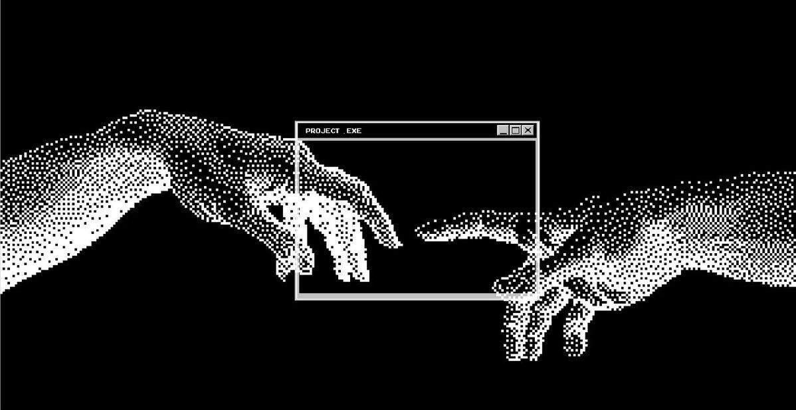
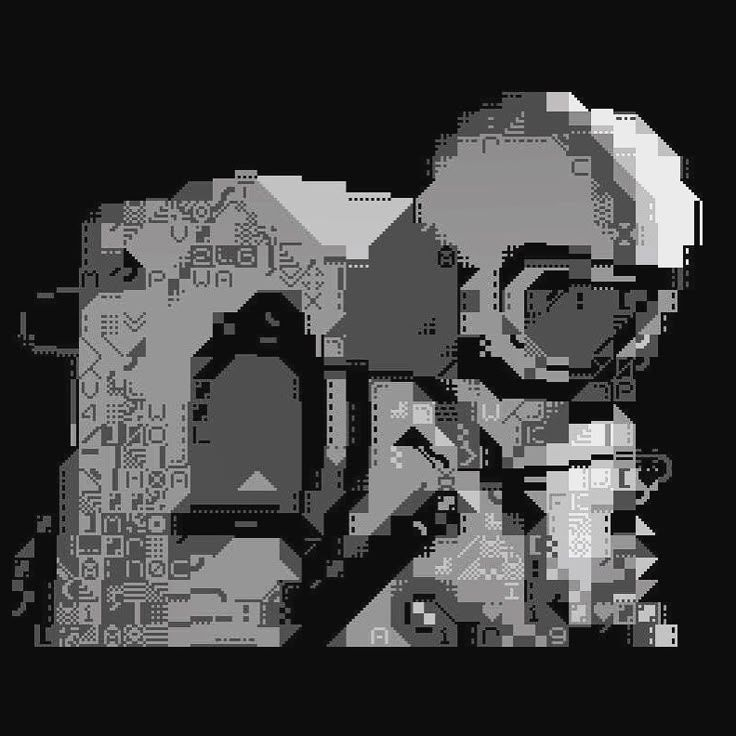

  

 

<table>
  <tr>
    <td align="center" colspan="2">
      <a href="https://portfolio-chi-beryl-27.vercel.app/"><strong>PORTFOLIO</strong></a>
      &nbsp;&nbsp;&nbsp;
      <a href="https://linkedin.com/in/arjunkrishnansuresh"><strong>LINKEDIN</strong></a>
      &nbsp;&nbsp;&nbsp;
      <a href="https://github.com/Arjunx156"><strong>GITHUB</strong></a>
    </td>
  </tr>
  <tr>
    <td width="66%" valign="middle">
      <h1>Hey there! I'm Arjun.</h1>
      
<strong>AI / Full-Stack Engineer</strong>

      
I build useful software around voice, retrieval, and agentic systems.

      
Currently turning language into interfaces, workflows, and products that feel human to use.

    </td>
    <td width="34%" align="center" valign="middle">
      
    </td>
  </tr>
</table>

 

## Pinned

<table>
  <tr>
    <td width="33%" valign="top">
      <h3>VoiceCare AI</h3>
      
Multilingual voice support with a 9-agent LangGraph pipeline for 9 Indian languages.

      
<code>Python</code> <code>FastAPI</code> <code>Next.js</code>

      <a href="https://frontend-roan-three-65.vercel.app/">Live demo</a> · <a href="https://github.com/Arjunx156/VoiceCare-AI">Source</a>
    </td>
    <td width="33%" valign="top">
      <h3>Schema Compiler</h3>
      
Plain English transformed into validated, execution-ready app specifications.

      
<code>Gemini</code> <code>Pydantic</code> <code>SSE</code>

      <a href="https://nl-app-compiler.vercel.app/">Live demo</a> · <a href="https://github.com/Arjunx156/nl-app-compiler">Source</a>
    </td>
    <td width="33%" valign="top">
      <h3>Production RAG</h3>
      
Hybrid retrieval with reranking, citations, memory, and an OpenAI/Ollama switch.

      
<code>ChromaDB</code> <code>Docker</code> <code>Streamlit</code>

      <a href="https://arjunx156.github.io/rag-system">Docs</a> · <a href="https://github.com/Arjunx156/rag-system">Source</a>
    </td>
  </tr>
</table>

 

  <code>Python</code> · <code>TypeScript</code> · <code>LangGraph</code> · <code>RAG</code> · <code>FastAPI</code> · <code>Next.js</code> · <code>Docker</code>

 

<strong>Building quietly. Open to good problems.</strong> 
<a href="https://linkedin.com/in/arjunkrishnansuresh">Say hello</a>

 

  Designed and built by Arjun Krishnan · 2026

