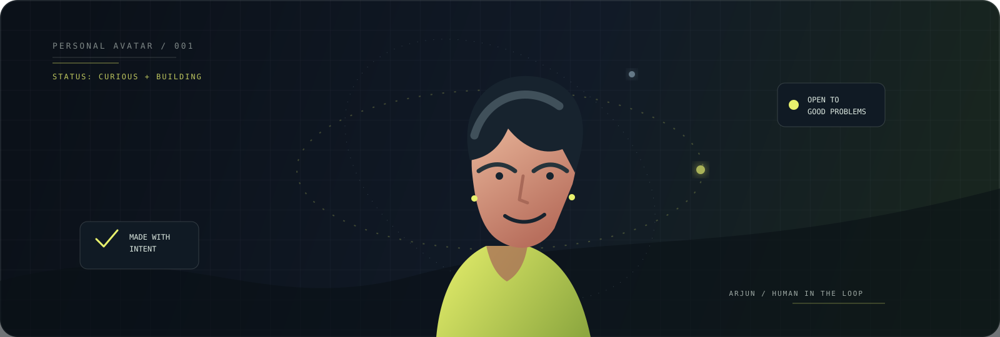

  

 

  <h1>Arjun Krishnan</h1>
  
<strong>AI / FULL-STACK ENGINEER</strong>

  
Turning unreasonable questions into useful systems.

  

    <a href="https://portfolio-chi-beryl-27.vercel.app/">PORTFOLIO</a>
    &nbsp; · &nbsp;
    <a href="https://linkedin.com/in/arjunkrishnansuresh">LINKEDIN</a>
    &nbsp; · &nbsp;
    <a href="https://github.com/Arjunx156">GITHUB</a>
  

 

<table>
  <tr>
    <td width="58%" valign="top">
      <h2>Currently building</h2>
      
Production-grade AI systems that can listen, retrieve, reason, and ship a result.

      <ul>
        <li>Voice agents for multilingual customer support</li>
        <li>Retrieval systems with grounded citations</li>
        <li>Agentic compilers that turn language into software</li>
      </ul>
    </td>
    <td width="42%" valign="top">
      <h2>Signal</h2>
      
<code>STATUS: CURIOUS + BUILDING</code>

      
<code>BASE: INDIA</code>

      
<code>OPEN TO: GOOD PROBLEMS</code>

    </td>
  </tr>
</table>

## Selected systems

<table>
  <tr>
    <td width="50%" valign="top">
      <h3>CommerceMind VoiceCare AI</h3>
      
Multilingual voice support powered by a 9-agent LangGraph pipeline. Resolves queries in 9 Indian languages in under 10 seconds.

      
<code>LangGraph</code> <code>FastAPI</code> <code>Gemini</code> <code>Next.js</code> <code>PostgreSQL</code>

      <a href="https://frontend-roan-three-65.vercel.app/">Live demo</a> · <a href="https://github.com/Arjunx156/VoiceCare-AI">Source</a>
    </td>
    <td width="50%" valign="top">
      <h3>NL -> App Schema Compiler</h3>
      
Plain English to validated, execution-ready app specifications. Broken layers are repaired without regenerating the whole result.

      
<code>FastAPI</code> <code>Gemini</code> <code>Pydantic</code> <code>Next.js</code> <code>SSE</code>

      <a href="https://nl-app-compiler.vercel.app/">Live demo</a> · <a href="https://github.com/Arjunx156/nl-app-compiler">Source</a>
    </td>
  </tr>
  <tr>
    <td colspan="2" valign="top">
      <h3>Production RAG System</h3>
      
Hybrid BM25 and dense retrieval fused with Reciprocal Rank Fusion, cross-encoder reranking, page-level citations, conversation memory, and an OpenAI/Ollama switch.

      
<code>FastAPI</code> <code>ChromaDB</code> <code>sentence-transformers</code> <code>Streamlit</code> <code>Docker</code>

      <a href="https://arjunx156.github.io/rag-system">Docs</a> · <a href="https://github.com/Arjunx156/rag-system">Source</a>
    </td>
  </tr>
  <tr>
    <td colspan="2" valign="top">
      <h3>Local LLM Benchmarking Assistant</h3>
      
Hardware-aware, fully offline model comparison across hand-crafted questions, live code execution, tokens per second, latency, time to first token, and peak RAM.

      
<code>FastAPI</code> <code>asyncio</code> <code>Streamlit</code> <code>Docker</code>

      <a href="https://github.com/Arjunx156/Local-LLM-Benchmarking-Assistant">Source</a>
    </td>
  </tr>
</table>

## Working stack

  <strong>LANGUAGES</strong> 
  Python · TypeScript · C++ · SQL

  <strong>AI / ML</strong> 
  LangGraph · RAG · TensorFlow · Keras · Prompt Engineering · Agentic AI

  <strong>BUILD</strong> 
  FastAPI · PostgreSQL · Next.js · React · Tailwind CSS · Docker · Google Cloud · Vercel

## Credentials

Google Cloud Gen AI Academy APAC 2026 · Oracle Cloud Infrastructure AI Foundations Associate · Published research on dual-phase BiLSTM battery management for IoT

 

  Designed and built by Arjun Krishnan · 2026

