<picture>
  <source media="(prefers-color-scheme: dark)" srcset="assets/hero-dark.svg">
  
</picture>

### I build AI systems and don't call them done until the numbers agree.

I'm Arjun, a B.Tech student in AI and Data Science at Amrita Vishwa Vidyapeetham, Faridabad. I like seeing the whole stack, from a loss curve to a WebSocket frame. Most weeks go to LLM systems and the research that keeps them honest. Every figure below is drawn from a project's real numbers.

[Portfolio](https://portfolio-chi-beryl-27.vercel.app) · [LinkedIn](https://www.linkedin.com/in/arjunkrishnansuresh/) · [Email](mailto:dl.ai.u4aid24107@dl.students.amrita.edu)

 

## Systems

LLM software that has to run, stream and stay up.

<table>
<tr>
<td width="50%" valign="top">

<picture>
  <source media="(prefers-color-scheme: dark)" srcset="assets/voice-dark.svg">
  
</picture>

**VoiceCare AI** 
Speak your problem in your own language and hear the fix back in under ten seconds. Nine LangGraph agents carry it from speech to a ticket, all over one WebSocket, with six hard escalation rules on the way.

LangGraph · Gemini 2.5 · Bhashini · FastAPI · Next.js · Postgres · Redis 
[Live demo](https://frontend-roan-three-65.vercel.app) · [Source](https://github.com/Arjunx156/VoiceCare-AI)

</td>
<td width="50%" valign="top">

<picture>
  <source media="(prefers-color-scheme: dark)" srcset="assets/fusion-dark.svg">
  
</picture>

**Hybrid RAG engine** 
Keyword search and vector search vote, then a cross-encoder picks what the model gets to read. Answers stream with page-level citations, and one environment variable swaps OpenAI for a local Ollama model.

FastAPI · ChromaDB · sentence-transformers · Ollama · Streamlit 
[Docs](https://arjunx156.github.io/rag-system/) · [Source](https://github.com/Arjunx156/rag-system)

</td>
</tr>
</table>

## Research

Two co-authored papers, with the failures written down too.

<table>
<tr>
<td width="50%" valign="top">

<picture>
  <source media="(prefers-color-scheme: dark)" srcset="assets/charge-dark.svg">
  
</picture>

**Intelligent battery management for IoT nodes** 
A four-head attention BiLSTM predicts state of charge on 19,735 readings, split by time so the future never leaks into training. The battery-health heads scored a negative R², and that went into the paper too.

Published, co-author · TensorFlow · BiLSTM · multi-head attention · Monte Carlo dropout

</td>
<td width="50%" valign="top">

<picture>
  <source media="(prefers-color-scheme: dark)" srcset="assets/relief-dark.svg">
  
</picture>

**Emergency resource allocation for Delhi** 
800 units of relief, 910 units of need, five districts. Urgency-weighted proximal gradient beat three other optimisers, and Dynamic Mode Decomposition spots a blocked route on its own, so service bends instead of breaking.

Research paper, co-author · MATLAB · proximal gradient · ADMM · DMD

</td>
</tr>
</table>

## Security

Break it first, then fix it properly.

<table>
<tr>
<td width="50%" valign="top">

<picture>
  <source media="(prefers-color-scheme: dark)" srcset="assets/intercept-dark.svg">
  
</picture>

**Man in the middle on Diffie-Hellman** 
Mallory swaps both public values and quietly holds both keys. Every primitive is hand-written, from Miller-Rabin to 512-bit RSA, and then a certificate authority signs the keys and the forgery fails.

Python · Miller-Rabin · RSA · PKI

</td>
<td width="50%" valign="top">

<picture>
  <source media="(prefers-color-scheme: dark)" srcset="assets/spike-dark.svg">
  
</picture>

**Adaptive Bandwidth Monitoring Protocol** 
A big download and data exfiltration look the same to a fixed threshold. ABMP learns normal from a rolling 20-second window and flags anything three standard deviations out, as a real three-state protocol.

Python · psutil · NumPy · WebSockets · Streamlit

</td>
</tr>
</table>

## Also built

**[Natural language to app schema compiler](https://github.com/Arjunx156/nl-app-compiler)**. Plain English in, validated UI, API, database and auth schemas out. Five Gemini stages pass 90% of a 20-test harness, and the repair engine reruns only the stage that failed. [Live](https://nl-app-compiler.vercel.app)

**[Local LLM benchmarking harness](https://github.com/Arjunx156/Local-LLM-Benchmarking-Assistant)**. Six open-weight models, forty tasks and three graders (exact match, LLM as judge, sandboxed code execution), all offline, with latency and throughput logged per model.

**[Kachra se Kamai](https://github.com/Arjunx156/kachra-se-kamai)**. Snap your dustbin and Amazon Nova prices your recyclables, then bundles pickups with your neighbours' for local waste pickers. Built on AWS SAM, Bedrock and Strands Agents.

**[Task manager agent](https://github.com/Arjunx156/task-manager-agent)**. Scheduling, notes and day planning split across Google ADK sub-agents, running as a managed service on Cloud Run.

 

<picture>
  <source media="(prefers-color-scheme: dark)" srcset="assets/hello-dark.svg">
  
</picture>

I'm looking for an internship in AI research, model evaluation or security. If your team cares whether the model is actually right, [write to me](mailto:dl.ai.u4aid24107@dl.students.amrita.edu) or find me on [LinkedIn](https://www.linkedin.com/in/arjunkrishnansuresh/).

Engineered by Arjun Krishnan Suresh. Every SVG here is generated by [`tools/build.ts`](tools/build.ts) from the same fonts and numbers as the portfolio.
